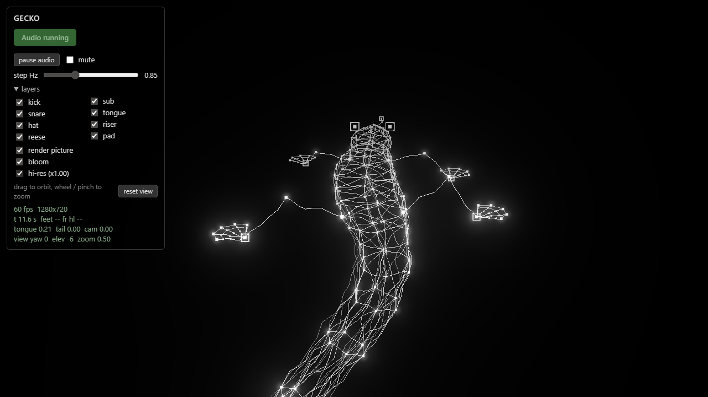

# Gecko

A wireframe gecko walks, and its walk is the sequencer: every foot landing is a kick or a snare,
the tongue flick is a growl, feet in the air are risers, the tail and the camera shape the mix.
No samples, no loops. three.js draws it, Web Audio plays it, one set of equations drives both.

**Live: https://pavle-goloskokovic.github.io/gecko-wireframe/** (click *Start audio*, headphones recommended)



## Controls

- **Start audio** starts the sound (browsers need a click for that). *pause audio* keeps the picture walking in silence, *mute* keeps everything running.
- **step Hz** sets the gait rate: walk, drums and tongue change together. 0.85 is half-time, 1.45 is drum & bass tempo.
- **layers** mute kick, snare, hats, reese bass, sub, tongue, riser and pad one by one.
- **drag** to orbit the camera, **wheel / pinch** to dolly, double-click or *reset view* to return. The sound follows the camera: the pad pans with it and the mix darkens with distance.
- **wobble** sets how much the wires bend and shimmer (the original shader's hand-drawn look); 0 gives straight lines.
- **hi-res** renders at the device pixel ratio; **bloom** and **render picture** can be switched off.

## Run it locally

```sh
npm install
npm run dev
```

`npm run build` type-checks and bundles into `dist/`, which GitHub Actions deploys to Pages on every push to `main`.

## How it works

Nothing in the gecko has state: every pose is a pure function of time, so the audio scheduler can
solve for the next foot landing instead of watching for it, and book each hit sample-accurately a
quarter second ahead. The full story, layer by layer, is in [docs/how-it-works.md](docs/how-it-works.md).

Source layout: `src/gait.ts` (motion, camera, events), `src/render.ts` (lines, nodes, bloom),
`src/audio.ts` (the synth graph and scheduler), `src/orbit.ts` (camera input), `src/main.ts` (clock and UI).

## License

MIT, see [LICENSE](LICENSE).
